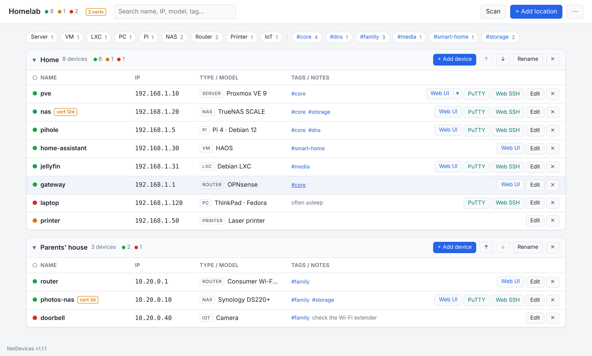
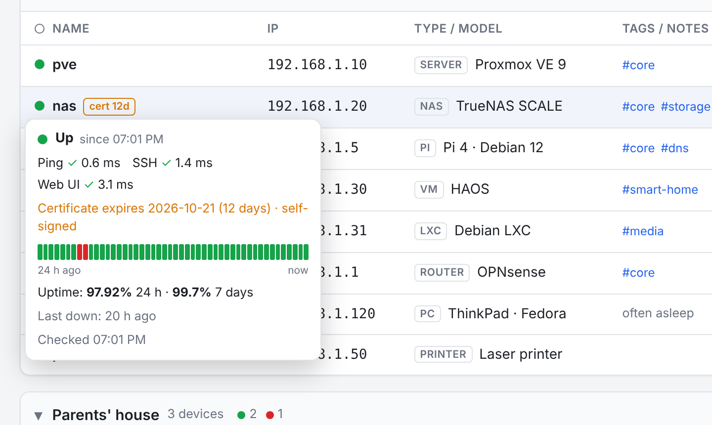
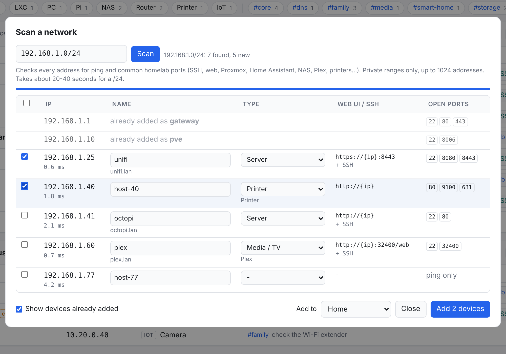
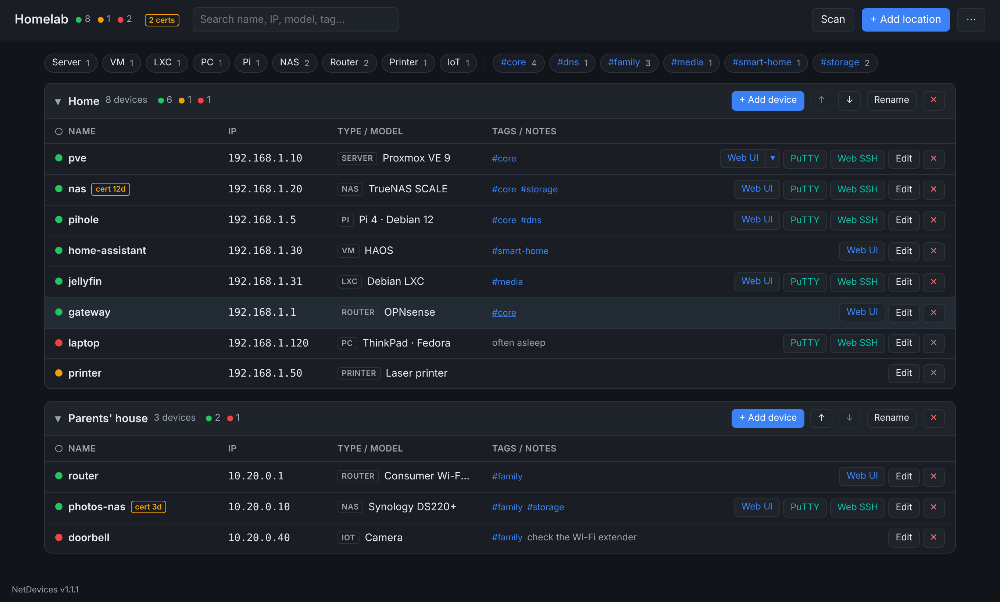
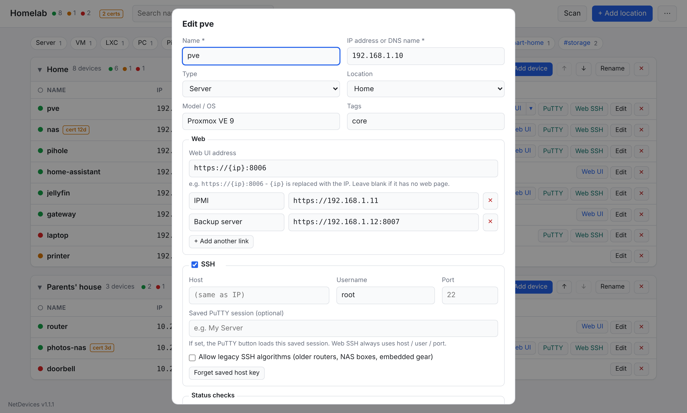

# NetDevices

**A small self-hosted dashboard for your homelab.** List your servers, VMs, containers, Pis, NAS,
laptops and network gear, grouped by location (your house, and the family houses you look after
over a tunnel). See at a glance what's up, and open each device's web UI, PuTTY or an in-browser
SSH terminal in one click.



- **Live status**: ping, SSH and web checks every 30 s, with green / amber / red dots, a 24-hour
  history strip, and 24 h / 7-day uptime.
- **One-click access**: a Web UI button plus extra links (IPMI, backup server…), **Web SSH** in the
  browser (host-key checked, key or password login), and **PuTTY** on your desktop. A device only
  shows buttons for the things it actually has.
- **Network scan**: finds what's on a subnet, recognises Proxmox, Home Assistant, Synology,
  Plex/Jellyfin, printers and more, and adds them in a few clicks.
- **Homelab-friendly**: types and tags with filter chips, click-to-copy IPs, sorting, TLS
  certificate expiry warnings, dark mode, works on a phone.
- **Small and self-contained**: one Docker container, one data folder, single-user login, daily
  automatic backups, no cloud and no internet access needed.

| | |
|---|---|
|  |  |
|  |  |

## Install

Needs a Linux host with Docker and the Compose plugin, on the same network as your devices.

```bash
git clone https://github.com/TenderBabyMeat/Network-Devices-Quickaccess.git netdevices
cd netdevices
./setup.sh
```

Or download the zip from the [latest release](https://github.com/TenderBabyMeat/Network-Devices-Quickaccess/releases/latest),
unzip it, and run `./setup.sh`.

`setup.sh` asks:

1. **Address to listen on**: all of the host's addresses, one specific IP, or this machine only
2. **Port** (default 8088)
3. **Data folder** (default `./data`)
4. **How often to run status checks** (default every 30 s)
5. **SSH key for Web SSH**: none (always ask for a password), generate a new one, or copy one in
6. **Reverse proxy**: only if you'll always use it through an HTTPS proxy

It then builds the image, starts the container, and prints the address and a **one-time setup
code**. Open the address, enter the code, and choose your password. The code means nobody else on
your network can claim a fresh install before you do.

Re-run `./setup.sh` any time to change settings (your current answers are the defaults).

| Command | What it does |
|---|---|
| `./setup.sh --status` | container state and address |
| `./setup.sh --update` | rebuild and restart with current settings (after replacing the app files) |
| `./setup.sh --code` | show the first-run setup code again |
| `docker compose logs -f netdevices` | live log |
| `docker compose exec netdevices python -m app.resetpw` | reset a forgotten password |
| `docker compose down` | stop |

## Updating

If you installed with `git clone`:

```bash
cd netdevices
git pull
./setup.sh --update
```

If you installed from a zip: unzip the new version **anywhere** and run `./setup.sh --update` from the
new folder. If NetDevices is already installed somewhere else, it offers to copy the new files into
that install (your `.env`, `data/` and `ssh-keys/` are never touched) and restarts it. If the install
folder or its `.env` went missing, it recovers the settings, and your database if needed, from the
running container.

The version is shown at the bottom left of every page. Don't delete the old folder before updating:
it holds your settings and data.

## Using it

- **Locations and devices**: a location is a household or network ("Home", "Mom's house"). Add,
  edit, move devices between locations, and reorder locations. Changes are saved on the server, so
  every browser sees the same list. If two tabs edit at once, the second save is refused and reloads
  instead of overwriting the first.
- **Type, model and tags**: give each device a type (server, VM, LXC, Pi, NAS, router, PC, IoT…), a
  model/OS, and tags like `media` or `critical`. Chips above the list filter by type and tag; click a
  `#tag` on a row to show just that tag. Search covers names, IPs, models, tags and notes.
- **Buttons only when configured**:
  - **Web UI** appears when the device has a web address. Add more links (e.g. iDRAC, PBS, a
    dashboard) and they go in a ▾ menu next to it. `{ip}` in an address is replaced by the IP.
  - **PuTTY** and **Web SSH** appear when **SSH** is ticked for the device.
- **Click to copy**: click a name or IP to copy it.
- **Sorting**: click the Name, IP or Type / model headers (again to reverse, a third time for your
  saved order). The hollow dot sorts by status. **Keep this order** saves a sort for every browser.
- **Status dots**: each device can be checked by ping, its SSH port, and its web UI. Only the checks
  that apply to it are run.
  - green: all checks pass
  - amber: some pass
  - red: none pass
  - hollow: not monitored

  Hover a dot, or tap it on a phone, for details:
  - check timings
  - a **24-hour strip** (each block is 30 minutes)
  - **uptime % for 24 h and 7 days** ("partly reachable" counts as up)
  - when it was last down

  History is kept for 30 days; time the app itself was stopped isn't counted.
- **Certificate warnings**: for `https://` web UIs the certificate's expiry date is read (self-signed
  is fine). A `cert 12d` badge appears 30 days before it expires, and the top bar counts them.
- **Scan**: enter a range like `192.168.1.0/24`. It finds everything that answers and shows open
  ports for SSH, web, Proxmox, Home Assistant, Synology, Plex/Jellyfin, printers and RDP, plus the
  reverse-DNS name. It suggests a name, type and web address for each. Tick what you want, choose a
  location, and **Add**. Devices you already have are marked. Only private ranges up to /22 can be
  scanned. MAC addresses aren't visible from inside Docker, so devices are found by IP.
- **Web SSH**: opens a terminal in a new tab, from any browser, phone or tablet, with nothing to
  install.
  - The first connection shows the device's **host key fingerprint** to confirm. After that, a
    changed key raises a warning *before* any password is sent.
  - Login uses the key from setup if there is one, then falls back to a password prompt. Passwords
    are never stored.
  - Older NAS boxes, routers and embedded gear that only speak outdated SSH: tick **Allow legacy SSH
    algorithms**.
  - Device rebuilt or reset: **Forget saved host key** in its editor.
- **PuTTY**: opens PuTTY on the PC you're using, with host/user/port or a **saved PuTTY session**.
  Each Linux PC needs a small link handler, installed once: *⋯ → PuTTY buttons: set up this PC*. The
  button is hidden on phones.
- **Backups**:
  - A full JSON backup is written **every day** to `data/backups/`, keeping the newest 14. See them
    under *⋯ → Automatic backups*, where you can download one or back up now.
  - *⋯ → Export* / *Import* move everything by hand. Import accepts exports from every version,
    including the old standalone page.
- **Page title**: *⋯ → Settings*.

### Upgrading from 1.0.x

Your data is upgraded automatically on first start. Two things work differently:

- **Web UI buttons**: devices with a blank web address used to get an `https://<IP>` button. Now they
  get none. Edit the device and add the address if you want one.
- **SSH buttons**: devices with no SSH details at all (no user, PuTTY session, custom host or port)
  are now marked *no SSH*. Tick **SSH** in the editor to bring their buttons back.

## Moving it to its permanent home

Everything lives in this folder: the app, `.env`, `data/` and `ssh-keys/`. To move it:

```bash
docker compose down
# copy the whole folder to the new host, then there:
./setup.sh
```

It runs anywhere Docker does: a VM, a bare-metal host, or a **Proxmox LXC** with Docker. For LXC,
enable *Options → Features → nesting* (and *keyctl* for unprivileged containers).

## Security notes

- Keep it on your LAN or VPN. It holds a map of your network and can open SSH sessions, so **don't
  expose it to the internet**.
- One password; sessions last 30 days (`ND_SESSION_DAYS`). Repeated wrong passwords are slowed
  down.
- The container runs as a normal user with no Linux capabilities and a read-only filesystem. It
  only writes to `data/`, and `ssh-keys/` is mounted read-only.
- Behind an HTTPS reverse proxy (e.g. Nginx Proxy Manager): answer *yes* to setup question 6, and
  turn on **WebSockets support** for the host in the proxy, which Web SSH needs.

## Troubleshooting

- **"ping unavailable" in the top bar**: the container wasn't allowed the ping setting
  (`net.ipv4.ping_group_range`). Some rootless/Podman setups refuse it. Port checks still work. Or
  untick *Ping* on devices.
- **Everything red**: the container can't reach your LAN. From the host, try
  `docker compose exec netdevices python -c "import socket; socket.create_connection(('192.168.1.1', 22), 3)"`
  with one of your device IPs.
- **Web SSH "negotiation failed"**: tick *Allow legacy SSH algorithms* for that device.
- **A device has no SSH / Web UI buttons**: buttons only appear once configured. Edit the device:
  tick **SSH**, or enter a Web UI address.
- **Scan finds nothing**: the container reaches your LAN through Docker's network, so scanning works
  for the networks the host can reach, including ones over a VPN or tunnel. Check that the host can
  ping something in that range.
- **PuTTY opens but doesn't load the session**: on that PC, run
  `~/.local/share/netdevices/putty-handler.sh --watch` and click a PuTTY button. It reports whether the
  click reached the handler and, if not, what intercepted it (a Firefox setting, the desktop portal used by
  Flatpak/Snap browsers, or another registered app). `--test "Session"` opens a link through every route a
  browser can use.
- **Which version am I running?** Bottom-left of every page. If the server was updated while a page was open,
  the label turns amber and offers a reload.

## Configuration reference (`.env`)

| Variable | Default | |
|---|---|---|
| `ND_BIND` / `ND_PORT` | `0.0.0.0` / `8088` | listen address and port on the host |
| `ND_DATA_PATH` | `./data` | database folder |
| `ND_KEYS_PATH` | `./ssh-keys` | private key(s) for Web SSH, mounted read-only |
| `ND_STATUS_INTERVAL` | `30` | seconds between status sweeps |
| `ND_STATUS_TIMEOUT` | `2` | seconds per check |
| `ND_COOKIE_SECURE` | `0` | `1` when only used over HTTPS |
| `ND_TRUSTED_PROXY` | `127.0.0.1` | reverse proxy IP whose `X-Forwarded-For` is trusted |
| `ND_UID` / `ND_GID` | your user | user the container runs as |

## License

[MIT](LICENSE)
